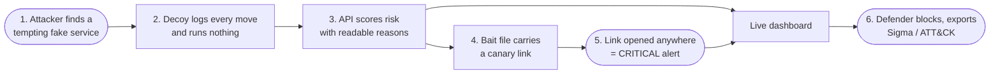
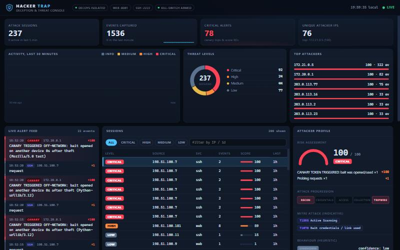
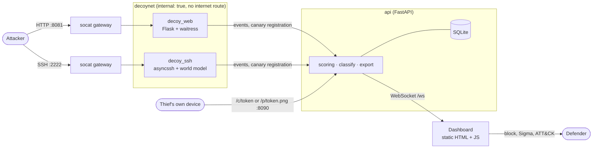
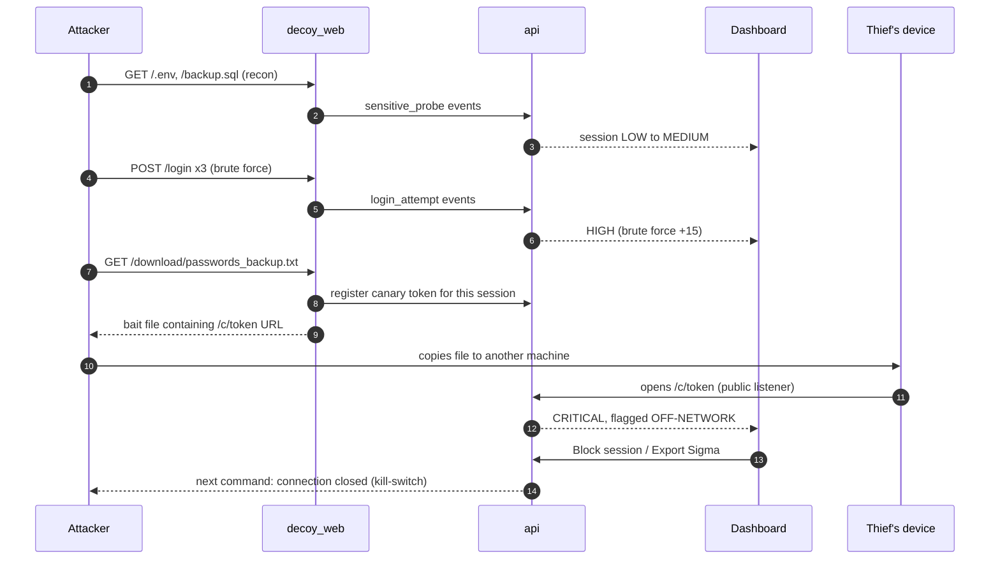
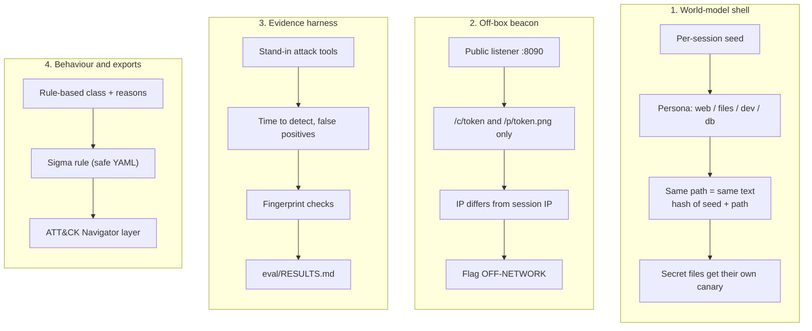

# Hacker Trap: a living deception system

Hacker Trap lures attackers into believable fake services, keeps them sealed in hardened containers, records every
move, scores the risk with reasons you can read, and alerts the defender live. A bait file carries a **canary
token** that fires even when the thief opens it on a different device. One click produces a firewall block rule,
a Sigma detection rule or an ATT&CK Navigator layer from what the attacker actually did.

> **Defensive tool for your own machine.** Decoys never execute anything an attacker types, ports bind to
> `127.0.0.1`, and block rules are generated as text only, never applied.

## How it works



1. **Lure.** A fake admin portal and a fake Ubuntu SSH box invite attackers in. Nothing real is behind them.
2. **Record.** Every request, login and command is logged. Commands are answered with generated text and never executed.
3. **Score.** The API adds up risk signals and shows exactly which behaviour earned each point.
4. **Tag.** Stolen bait files contain a unique canary link tied to that attacker's session.
5. **Alert.** Opening the link, even from another device, turns the session CRITICAL and is flagged off-network.
6. **Respond.** The defender watches live, cuts the session, and exports a block rule, a Sigma rule or an ATT&CK layer.



---

## Contents

0. [How it works](#how-it-works)
1. [What it does](#what-it-does)
2. [Quickstart](#quickstart)
3. [Architecture](#architecture)
4. [How an attack flows](#how-an-attack-flows)
5. [Risk scoring](#risk-scoring-explainable)
6. [The four novelty features](#the-four-novelty-features)
7. [Defender console](#defender-console)
8. [API reference](#api-reference)
9. [Configuration](#configuration)
10. [Demo script (3 minutes)](#demo-script-3-minutes)
11. [Tests and evidence](#tests-and-evidence)
12. [Security model and known limits](#security-model-and-known-limits)
13. [Repository layout](#repository-layout)

---

## What it does

| Capability | How |
|---|---|
| Believable decoys | Fake "Northwind Corp" admin portal (web) and a fake Ubuntu 20.04 box (SSH) |
| Nothing is ever executed | The shell is a text lookup; there is no call to a shell or the OS |
| Sealed in | Decoys run on an `internal` Docker network, read-only, all capabilities dropped |
| Live alerting | Events stream to the dashboard over WebSocket |
| Explainable risk | Additive score; every point is listed with its reason |
| Canary token | Bait file embeds a per-session URL; opening it makes the session CRITICAL |
| Operator response | Block rule, kill-switch (cuts a live session), Sigma rule, ATT&CK layer |

---

## Quickstart

**Requirements:** Docker Desktop (recommended) or Python 3.12. The attacker demo's SSH phase needs `pip install asyncssh`.

```powershell
docker compose up --build -d          # api, web decoy, ssh decoy
python attacker_demo/attack.py        # scripted attacker (add --fast to skip pauses)
start http://127.0.0.1:8000           # defender console
```

**No Docker?** One command, own virtualenv, same ports:

```powershell
python run_local.py                   # --reset wipes data, --attack runs the demo attacker
```

Local mode has no container isolation (the decoys are still harmless). Use Docker for the safety story.
Reset all data with `docker compose down -v`.

| What | Where |
|---|---|
| Defender console | http://127.0.0.1:8000 |
| Decoy admin portal | http://127.0.0.1:8081 (container port 8080) |
| Decoy SSH | `ssh admin@127.0.0.1 -p 2222` (accepts your 2nd password attempt) |
| Public beacon listener | http://127.0.0.1:8090 (serves only `/c/*` and `/p/*.png`) |

---

## Architecture



| Component | Role |
|---|---|
| `decoy_web` | Fake admin login. After 3+ failures (or a weak admin password) the attacker "gets in" and can download `passwords_backup.txt`. Serves tempting `/.env` and `/backup.sql`. Apache-style error pages. |
| `decoy_ssh` | In-memory fake Linux box per session. Every command is logged and answered from generated text. |
| `api` | Stores events, scores risk, classifies behaviour, serves canary endpoints, exports rules, streams to the dashboard. |
| Dashboard | Live feed, sessions, replay, risk reasons, behaviour, response actions. Attacker text is rendered with `textContent` only. |
| gateways | Two tiny `socat` containers so decoys can be reached without giving them a route out. |

---

## How an attack flows



---

## Risk scoring (explainable)

| Signal | Points |
|---|---|
| Login attempt | +5 |
| Brute force (3+ failures) | +15 |
| Got past the fake login | +20 |
| Suspicious command | +15 each |
| Sensitive file probe | +10 |
| Bait downloaded | +25 |
| **Canary triggered** | **CRITICAL (100)** |

`LOW < 20 <= MEDIUM < 50 <= HIGH < 90 <= CRITICAL`. Each session shows its breakdown. The rules are deliberately
simple and inspectable; there is no black-box model.

---

## The four novelty features



1. **World-model shell** (`decoy_ssh/worldgen.py`). Each SSH session gets its own self-consistent machine: hostname,
   IP, users, processes, files, `df`, `free`, `last`. Re-reading a file returns identical text, and every generated
   secret file carries its own path-labelled canary. Optional local-LLM mode (`OLLAMA_URL`) fills only non-secret files
   and falls back to rules on any failure. It works under `run_local.py`, not inside the isolated Docker network.
2. **Off-box beacon.** A second listener on `PUBLIC_PORT` serves only the canary routes and answers every miss with the
   same boring 404. A hit from an IP different from the thief's session is flagged *off-network*. It needs a public
   URL (tunnel or reverse proxy, `CANARY_BASE`; `PUBLIC_TRUST_CF=1` behind Cloudflare). **This repo starts no tunnel.**
3. **Evidence harness** (`eval/run_eval.py`). Measures detection per attack type, time to detect, false positives on
   benign browsing and fingerprint tells. Its first run found two real tells (RSA-only SSH host key, Flask error pages),
   which are fixed.
4. **Behaviour class and exports.** Labels each session `automated-scanner`, `scripted-tool`, `likely-human` or
   `unknown` with reasons (heuristic, not ML). Exports a Sigma rule and an ATT&CK Navigator layer built only from
   observed behaviour. Sigma is produced with `yaml.safe_dump`, so attacker text cannot inject YAML.

---

## Defender console

SOC-style single page served by the api: KPI strip, activity chart, live alert feed, session table with risk badges,
and a detail pane with:

- risk score breakdown and the behaviour class with reasons
- replay timeline (press **Play replay**)
- **Block this session** (kill-switch: the next command on a live SSH session is refused), **Copy perimeter rule**
- **Export Sigma rule** and **Download ATT&CK layer**
- a banner when a canary fires, with an extra "off-network" wording when the thief opened it elsewhere

---

## API reference

| Method | Path | Purpose |
|---|---|---|
| GET | `/health` | liveness |
| POST | `/events` | decoys submit events (needs `X-Trap-Key`) |
| POST | `/canary` | decoys register a token for a session (needs `X-Trap-Key`) |
| GET | `/c/{token}`, `/p/{token}.png` | canary link and 1x1 pixel (also on the public listener) |
| GET | `/sessions`, `/sessions/{id}` | session list; detail with events, score reasons, behaviour |
| GET | `/sessions/{id}/sigma` | Sigma rule (text/plain) |
| GET | `/sessions/{id}/navigator` | ATT&CK Navigator layer (JSON) |
| GET | `/stats`, `/analytics`, `/metrics` | counters, per-minute buckets, metrics |
| POST | `/block-rule` | firewall rule text for an IP |
| POST | `/block`, `/unblock`; GET `/blocked/{id}` | kill-switch |
| WS | `/ws` | live event stream |

---

## Configuration

| Variable | Where | Default | Meaning |
|---|---|---|---|
| `TRAP_KEY` | api, decoys | `trap-demo-key` | shared secret between decoys and api. **Change it for anything but a demo.** |
| `CANARY_BASE` | decoys | `http://127.0.0.1:8000` | URL embedded in bait. Set to your public URL to catch off-network opens. |
| `PUBLIC_PORT` | api | `8090` (compose) | public beacon listener; unset to disable |
| `PUBLIC_TRUST_CF` | api | `0` | trust `CF-Connecting-IP` (only behind Cloudflare) |
| `TRUST_XFF` | decoy_web | demo only | trust `X-Forwarded-For`; **never on a public deployment** |
| `WORLD_MODEL` | decoy_ssh | `1` | `0` = original static fake box |
| `OLLAMA_URL`, `OLLAMA_MODEL` | decoy_ssh | unset | optional LLM content for non-secret files |

---

## Demo script (3 minutes)

1. Open the console on one side and a terminal on the other.
2. `python attacker_demo/attack.py`; narrate each `[ATTACKER]` step.
3. Show the live feed filling, the red canary banner and the session turning CRITICAL.
4. Open the session: read the score reasons and the behaviour class, press **Play replay**.
5. Press **Export Sigma rule**, then **Block this session**.
6. Optional: `ssh admin@127.0.0.1 -p 2222`, enter any password twice, run `ls`, `cat passwords_backup.txt`.
   Connect twice and compare `hostname`: each session is a different machine.

---

## Tests and evidence

```powershell
python tests/test_fakefs.py       # offline
python tests/test_worldmodel.py   # offline
python tests/test_export.py       # offline
python tests/test_smoke.py        # needs the stack (docker compose up)
python tests/test_beacon.py       # needs the stack; PUBLIC_TRUST_CF=1 on the api exercises the off-network case
python eval/run_eval.py           # needs the stack; writes eval/RESULTS.md
```

Last full run under Docker: 5 + 10 + 7 + 8 + 5 tests passing. The harness (lab, loopback, my own stand-in tools)
detected every attack type 5/5 and flagged 0 of 5 benign page loads. See [`eval/RESULTS.md`](eval/RESULTS.md) for
the numbers and what they do **not** show. `nmap`, `ssh-audit` and `nikto` are used if installed, otherwise skipped.

---

## Security model and known limits

Hardening (`docker-compose.yml`): `internal` decoy network, read-only root filesystem, `cap_drop: ALL`,
`no-new-privileges`, non-root users, memory/CPU/pid limits, no host mounts, ports on `127.0.0.1` only.

Be upfront about these:

- **Egress is blocked for decoys** in the Docker setup only, not under `run_local.py`.
- **Source IPs:** behind Docker Desktop on Windows the SSH decoy sees Docker's gateway IP. The web demo trusts
  `X-Forwarded-For` so the script can simulate a source IP.
- **No login on the dashboard or `/block-rule`** (demo scope). Do not expose port 8000.
- **Off-network detection** fires on any open of the URL (a VPN, a mail scanner or a link previewer included).
  Treat it as strong evidence, not proof of a second human.
- **Canary registration is asynchronous.** A link opened within milliseconds of download can be missed.
- **Behaviour class is a heuristic**, and the harness uses stand-in tools in a lab. Passing it does not mean the decoy is
  undetectable; `Via: waitress` is still visible on the web decoy.
- **State is in memory** for the brute-force and login tracking; restarting a decoy forgets who was "logged in".
- `decoy_mysql/` is unfinished work and is not part of the compose stack.

---

## Repository layout

```
api/            FastAPI app: scoring, classify.py, export.py, static/index.html (dashboard)
decoy_web/      Flask decoy portal, templates, bait template
decoy_ssh/      asyncssh server, fakefs.py (shell), worldgen.py (world model)
decoy_mysql/    work in progress, not in compose
attacker_demo/  scripted attacker
eval/           run_eval.py, RESULTS.md, results.json
tests/          fakefs, worldmodel, export, smoke, beacon
run_local.py    no-Docker runner
plan2.md        the four-idea plan and its status
DECISIONS.md    what was built, cut and why
```

## Credits

Python, FastAPI, Flask, waitress, asyncssh, PyYAML. Honeypot and canary-token concepts follow the public work of the
Honeynet Project, Cowrie and Thinkst Canary; MITRE ATT&CK and Sigma are used as open formats.
